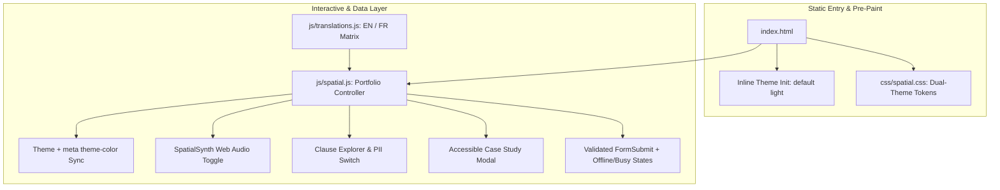

# Tactile Craft Bento Dual-Theme Portfolio Rework Plan

> **For agentic workers:** REQUIRED SUB-SKILL: Use superpowers:subagent-driven-development (recommended) to implement this plan task-by-task via fresh `implementer`, `spec-reviewer`, and `code-reviewer` dispatches. Steps use checkbox (`- [ ]`) syntax for tracking.

**Goal:** Overhaul Anandhu Krishna's static portfolio (`index.html`, `css/spatial.css`, `js/spatial.js`, `js/translations.js`, and image assets) into **Option 4 — Tactile Craft Bento** with **Light Mode as the default theme**, full **Dark Mode persistence**, crystal-clear **dual-theme SVG architecture schematics**, interactive project micro-demos, full **EN / FR bilingual parity**, retained **Web Audio sound toggle**, and zero AI-portfolio clichés.

**Architecture:** Plain static multi-file web app served directly at root (`anandhukrishna.dev`). CSS custom properties in `css/spatial.css` define semantic Light (`:root` / `[data-theme="light"]`) and Dark (`[data-theme="dark"]`) tokens matching `DESIGN.md`. An inline pre-paint script reads `localStorage['spatial_theme']` (defaulting to `'light'`) to avoid theme flicker, while `js/spatial.js` manages theme persistence + `<meta name="theme-color">` sync, mobile menu drawer focus/escape, Web Audio feedback (`SpatialSynth`), quick copy-email, interactive micro-demos (Clause Explorer tabs + PII Guardrail toggle), Case Study modal dialog, and validated FormSubmit handling. All text keys live in `js/translations.js` across both `en` and `fr`.

**Architecture Diagram:**

**Tech Stack:** Semantic HTML5, CSS3 Custom Properties + CSS Grid + `@media (hover: hover)`, Vanilla ES6+ JavaScript, Web Audio API (`AudioContext`), Google Fonts (`Bricolage Grotesque`, `Manrope`, `Martian Mono`), Font Awesome 6.4.0 CDN (kept cleanly for brand social glyphs if needed or lean SVG icons), Google Analytics (`gtag.js` `G-W3K41TT4G4`), FormSubmit AJAX endpoint.

**Spec:** [DESIGN.md](file:///d:/website_akr/Anandhu-Krishna/DESIGN.md)

---

## Global Constraints

- **Default Theme & Persistence:** Light Mode is default when `localStorage.getItem('spatial_theme')` is unset; switching writes `'light'` or `'dark'` to `'spatial_theme'`, toggles `data-theme="dark"` (plus backward-compatible `body.light-mode` absence / presence checks updated cleanly), and updates `<meta name="theme-color">`.
- **100% Real Data Preservation:** Keep every real detail, project URL, company/school name, metric (`-15%` churn, `+25%` engagement, `62%` forecast accuracy, `25+` document parsers), email (`anandhukrishna091@gmail.com`), phone (`+33 07 80 86 43 13`), CV PDF URL (`https://drive.google.com/file/d/1BaO4R_H0K6MxnnrzueMbCl30-3omoC8e/view?usp=sharing`), social links (GitHub, LinkedIn, X/Twitter, Medium), FormSubmit endpoint (`https://formsubmit.co/ajax/anandhukrishna091@gmail.com`), `_honey`, `_captcha=false`, `G-W3K41TT4G4`, and `CNAME`.
- **All Existing Sections Retained:** Top navigation, Hero, About (narrative + 4 spec tiles), Experience & Education (Hubicus AI Engineer, Hubicus Intern, AXA Intern, 6D Technologies, EPITA MSc), Projects (4 projects), Skills (4 clusters, all 38 tokens), Contact (direct coordinates + FormSubmit form), Footer (dynamic year + 4 social links).
- **Retained Interactive Controls:** Keep EN/FR bilingual toggle (`#lang-switch`, `localStorage['preferredLanguage']`) with **zero remaining hardcoded untranslated UI text**, and keep Web Audio toggle (`#sound-toggle`, `localStorage['spatial_audio']`).
- **Replace Garbled Project JPEGs & Optimize Portrait:** Remove all `` references from `index.html` and replace them with custom dual-theme inline `<svg>` architecture diagrams. Optimize `images/about.jpg` to web dimensions (`<= 900px` wide, `<= 150 KB` cleanly) and inspect visually.
- **Zero AI Portfolio Clichés & Accessibility Floor:** Remove pulsing dots, radial halos, particle canvas, 3D tilt wobble, gradient rainbow text, `"Zero Syntax Errors"`, `"Initiate Transmission"`, `01 // ...`, `[LATENCY: ~12ms]`. Enforce WCAG 2.2 AA contrast in both themes, `16px+` form inputs on mobile, `44px+` touch targets, visible focus rings, `@media (hover: hover) and (pointer: fine)`, and `@media (prefers-reduced-motion: reduce)`.

## Review Focus

1. **Pre-paint theme flash & meta bar sync:** Reloading in Dark Mode (`spatial_theme='dark'`) must NOT flash Light Mode before paint, and `<meta name="theme-color">` must dynamically match `#ECEEF2` (Light) vs `#121316` (Dark).
2. **Untranslated dynamic strings on FR switch:** Switching to `FR` must translate section labels, Project 4 modal brief, interactive micro-demo tabs/PII snippet copy, `"Copy Email"` -> `"Email copié"`, validation errors, and FormSubmit loading/success/error strings — never leaving English strings mixed in French mode.
3. **Mobile (< 768px) navigation, grids & tap targets:** Existing `mobile` stylesheet hid nav links completely; responsive drawer must open/close cleanly (`Escape` & click-outside), `8/4`, `6/3/3`, `7/5` bento grids must collapse cleanly to `1fr` without horizontal scroll, and `touch-action: manipulation` + gated hover must work cleanly.
4. **Dual-theme company marks & inline SVGs:** Ipsos BVA and AXA marks must look sharp without dark rectangular halos bleeding on `#F9FAFC` Light Mode cards, and every SVG node diagram text/stroke must remain `>= 4.5:1` in both themes.
5. **Contact form edge states:** Submitting while empty/invalid shows accessible per-field validation (`aria-invalid`, `aria-describedby`), submitting while offline (`!navigator.onLine`) shows an immediate bilingual offline recovery notice without locking the form, and active submission disables double-POST (`aria-busy="true"`).

---

## File Structure & Responsibility Map

| File | Action | Responsibility |
| :--- | :--- | :--- |
| `DESIGN.md` | Already Locked (Phase 3) | Source of truth for tokens, typography, shapes, layout, motion, bans |
| `images/about.jpg` | Optimize (Resize/Re-encode) | Shrink from 1.52 MB to clean `840x980` web-optimized JPEG (`< 150 KB`) |
| `images/ipsos_mark.svg` | Create (Clean Vector) | Lightweight crisp Ipsos emblem/wordmark without 103 KB dark PNG radial box |
| `css/spatial.css` | Rewrite Cleanly | Option 4 dual-theme token system, typography, double-bezel tiles, responsive grids, interactive demo styles, accessible modal, states, mobile-native & reduced motion |
| `index.html` | Rewrite Cleanly | Semantic structure for all sections, pre-paint Light/Dark init script, Google Fonts (`Bricolage Grotesque`, `Manrope`, `Martian Mono`), mobile drawer, inline SVG schematics, micro-demo markup, Project 4 Case Brief dialog, validated contact form |
| `js/translations.js` | Expand & Polish | Complete EN / FR dictionaries covering every static node, interactive micro-demo, modal brief, copy state, and form validation/network message (removing clichés) |
| `js/spatial.js` | Rewrite Cleanly | Preserved `SpatialSynth` (`#sound-toggle`), theme toggle (`#dark-mode-toggle`) + `theme-color` sync, bilingual engine (`#lang-switch` + dynamic callbacks), mobile drawer controller, Copy Email utility, Clause Explorer tabs, PII Switch toggle, accessible Case Study modal, and FormSubmit state machine |

---

### Task 1: Asset Optimization & Clean Vector Organization Mark

**Files:**
- Modify: `images/about.jpg` (optimize dimensions & file size via lossless-look high-quality re-encode, keeping `d:\website_akr\Anandhu-Krishna\images\about-original-backup` nowhere in repo — verify visually via `read_file`)
- Create: `images/ipsos_mark.svg` (lightweight crisp dual-theme compatible vector mark for Hubicus / Ipsos BVA rows; note clean vector `images/axa_logo.svg` already exists at 4.6 KB — inspect/reuse cleanly!)

- [ ] **Step 1: Inspect `images/axa_logo.svg` dimensions/viewBox**
  Read `images/axa_logo.svg` so we confirm whether it renders cleanly on both `#F9FAFC` and `#1A1C21` without `axa_badge.svg`'s dark gradient backdrop.
- [ ] **Step 2: Optimize `images/about.jpg` to `<= 150 KB`**
  Use `.NET` `System.Drawing` in PowerShell to load `images/about.jpg`, high-quality bicubic resize to `840px` wide (preserving exact aspect ratio `~840x1120`), save at JPEG quality `86`, verify new size `< 150 KB`, and visually inspect with `read_file` to guarantee crisp facial detail and zero compression artifacts.
- [ ] **Step 3: Author lightweight `images/ipsos_mark.svg`**
  Create clean vector SVG (`viewBox="0 0 64 64"`, `< 1 KB`) replacing the 103 KB dark-halo raster-in-SVG `ipsos_bva_badge.svg`, crisp in both Light and Dark mode (`fill="none"` transparent ground sitting cleanly inside beveled tray frame).
- [ ] **Step 4: Commit asset updates**
  Stage `DESIGN.md`, `images/about.jpg`, `images/ipsos_mark.svg` and commit: `chore: lock DESIGN.md and optimize portrait/badge assets`.

---

### Task 2: Dual-Theme Token Architecture & Option 4 Design System CSS (`css/spatial.css`)

**Files:**
- Modify: `css/spatial.css` (clean replacement implementing `DESIGN.md`)
- Test/Verify via: automated token/slop check (`impeccable detect --json` + CSS inspection)

**Interfaces:**
- Produces root variables (`--bg`, `--surface`, `--tray`, `--border-subtle`, `--border-control`, `--text`, `--muted`, `--accent`, `--accent-ink`, `--accent-tint`, `--btn-fg`, `--rim`, `--status-success`, `--status-error`), `:root` = Light Default, `[data-theme="dark"]` (and `body.dark-mode`) = Dark Mode.
- Produces layout classes `.nav-pill`, `.mobile-drawer`, `.bento-grid`, `.bento-tile`, `.bento-inner`, `.tile-hero`, `.tile-portrait`, `.bento-r2`, `.bento-r3`, `.micro-tray`, `.tab-bar`, `.switch-control`, `.svg-well`, `.career-strip`, `.skills-grid`, `.contact-grid`, `.case-dialog`, `.form-error`, `.form-feedback`.

- [ ] **Step 1: Write semantic CSS custom properties, reset, base typography & accessibility foundations**
  Define Light tokens on `:root`, Dark tokens under `[data-theme="dark"]` (plus `color-scheme: light` / `dark`), `mobile-native` baseline (`-webkit-tap-highlight-color: transparent`, `overscroll-behavior: none`, `16px` input minimum on coarse/all pointers, `touch-action: manipulation`, `user-select: none` scoped strictly to buttons/tabs/pills), visible `:focus-visible` `2px solid var(--accent)` outline with `2px` offset, and `@media (prefers-reduced-motion: reduce)` override.
- [ ] **Step 2: Implement Detached Pill Header & Responsive Mobile Navigation Drawer**
  Style `.nav-pill` (`max-width: 1240px`, `--surface`, `--border-subtle`, `--rim`, `--shadow-nav`), single-row desktop anchors + controls (`min-width: 44px; min-height: 44px` hit areas), and `< 768px` toggleable `.mobile-drawer` with smooth `--duration-fast` (`250ms`) open / `--duration-quick` (`150ms`) close asymmetry.
- [ ] **Step 3: Implement Double-Bezel Bento Grids, Portrait Frame, SVG Wells, Interactive Micro-Demos & Case Dialog**
  Build outer `.bento-tile` (`padding: 8px; border-radius: 18px`) + inner `.bento-inner` (`border-radius: 12px`), responsive `8/4`, `6/3/3`, `7/5` / `5/7`, `2x2` grids collapsing cleanly to `1fr` at `< 768px`. Gate hover highlights inside `@media (hover: hover) and (pointer: fine)` (zero 3D JS tilt). Style `.svg-well` vector text/strokes cleanly via tokens, `.tab-btn[aria-selected="true"]`, `.switch-btn[aria-checked="true"]`, `<dialog>`/`#case-modal`, `.career-strip`, `.contact-grid`, `.field-error`, `.is-copied`, and `--status-success` / `--status-error` alerts.
- [ ] **Step 4: Verify zero syntax issues & contrast completeness**
  Inspect rendered variables against `DESIGN.md` tokens and verify zero hardcoded dark-only hex leaks.
- [ ] **Step 5: Commit stylesheet**
  Commit `css/spatial.css`: `style: implement Tactile Craft Bento dual-theme CSS system`.

---

### Task 3: Complete EN / FR Bilingual Dictionary & Cliché Cleanup (`js/translations.js`)

**Files:**
- Modify: `js/translations.js`

**Interfaces:**
- Produces global `translations = { en: { ... }, fr: { ... } }` supporting static `data-translate` HTML nodes, `data-translate-placeholder` attributes, `data-translate-aria` attributes, dynamic interactive demo strings (`demo_clause_*`, `demo_pii_*`), copy feedback (`email_copied`), Case Study 04 modal copy (`modal_p4_*`), and FormSubmit validation/status strings (`form_err_*`, `form_sending`, `form_sent`, `form_failed`, `form_offline`).

- [ ] **Step 1: Author polished, cliché-free English & French core section copy**
  Preserve every factual role, date, school, metric, and technical item while removing generic clichés (`"01 // Neural Profile"`, `"Zero Syntax Errors"`, `"Curating Knowledge"`, `"Initiate Transmission"`, `"Sender Identifier"`, `"Return Vector"`). Replace with crisp senior engineering copy:
  - About Heading EN: `"Engineering systems from research to sovereign production."` / FR: `"Ingénierie IA, de la recherche à la production souveraine."`
  - Hero Headline EN: `"Quantized LLM serving, verifiable RAG & graph pipelines."` / FR: `"Inférence LLM quantifiée, RAG vérifiable et graphes de connaissances."`
  - Contact Heading EN: `"Start a conversation"` / FR: `"Échanger sur un projet"`
  - Form Labels: concise real labels (`Name / Organization`, `Email`, `Subject`, `Message` and French equivalents `Nom / Organisation`, `Email`, `Objet`, `Message`).
- [ ] **Step 2: Add full translations for Hero Sub-Tiles, Interactive Micro-Demos, Project 4 Modal Brief & Form/Copy UI States**
  Add exact `en` and `fr` keys for:
  - Clause Explorer tabs (`Liability Clause`, `Deductible`, `Exclusions`) + corresponding node attributes (`CAP -> EUR 2.5M`, `RIDER -> SUB_B`, etc.).
  - PII Guardrail toggle states (`PII Masking: ON` / `OFF`, masked vs unmasked query snippets in EN/FR).
  - Case Study 04 modal brief (`Problem`, `Architecture`, `Production Outcomes: -15% Churn · +25% Engagement · 62% Accuracy`, `Close`, `Inquire via Contact`).
  - Form states (`Required field`, `Enter a valid email`, `You appear offline`, `Sending...`, `Message sent — I will reply promptly.`, `Delivery failed — please email anandhukrishna091@gmail.com.`).
- [ ] **Step 3: Validate JS syntax & key symmetry between `en` and `fr`**
  Run a quick Node script verifying `Object.keys(translations.en)` equals `Object.keys(translations.fr)` with zero missing keys!
- [ ] **Step 4: Commit translations**
  Commit `js/translations.js`: `feat(i18n): complete EN/FR matrix with demo, modal, and UI state keys`.

---

### Task 4: Tactile Bento HTML Architecture & Dual-Theme SVG Schematics (`index.html`)

**Files:**
- Modify: `index.html`

**Interfaces:**
- Consumes `css/spatial.css`, `js/translations.js`, `images/about.jpg`, `images/ipsos_mark.svg`, `images/axa_logo.svg`.
- Preserves IDs `#dark-mode-toggle`, `#sound-toggle`, `#lang-switch`, `#year`, `#hero`, `#about`, `#experience`, `#projects`, `#skills`, `#contact`, `#spatial-contact-form`, `#submit-btn`, `#form-feedback`.
- Adds `#mobile-nav-toggle`, `#mobile-drawer`, `#copy-email-hero`, `#copy-email-contact`, `[data-clause-tab]`, `#pii-toggle`, `#case-study-dialog`, `#open-p4-modal`, and per-field error `` elements linked via `aria-describedby`.

- [ ] **Step 1: Upgrade `<head>` for Light default, zero-FOUC theme hydration, Google Fonts & `viewport-fit=cover`**
  Include Google Fonts (`Bricolage Grotesque:wght@600;700;800`, `Manrope:wght@400;500;600;700`, `Martian+Mono:wght@400;600`), `<meta name="viewport" content="width=device-width, initial-scale=1, viewport-fit=cover">`, light/dark `<meta name="theme-color" id="meta-theme-color" content="#ECEEF2">`, GA snippet (`G-W3K41TT4G4`), favicons, and an inline 6-line pre-paint script setting `document.documentElement.dataset.theme = saved === 'dark' ? 'dark' : 'light'` before first render.
- [ ] **Step 2: Build Top Pill Header, Mobile Drawer & Hero (`8/4` + `6/3/3`) Bento Opening**
  Render clean detached pill nav with `Anandhu Krishna` wordmark, 5 section links, `EN / FR`, Theme button, Audio button, and mobile menu button. Render Hero `8/4` tile (kicker chip, concise identity headline, `Copy Email` button, `Curriculum Vitae ↗` Drive PDF link, `Explore Work` jump, GitHub/LinkedIn links; optimized `about.jpg` portrait tile) and `6/3/3` sub-row (`Inference & Serving Runtime`, `-15%` Churn / `+25%` Engagement metric tile, `Paris, FR` coordinates & links).
- [ ] **Step 3: Build About Section (`7/5` narrative + `2x2` specs) & Experience/Education Hardware Timeline**
  Render About bio + all 4 real specs (`Location`, `Specialization`, `Master's Degree`, `Languages`). Render all 5 Career/Education nodes (`Hubicus AI Engineer 06/2026`, `Hubicus Intern 11/2025`, `AXA Intern 03/2025`, `6D Technologies 02/2021`, `EPITA MSc 2023–2025`) with crisp dual-theme logos/monograms (`ipsos_mark.svg`, `axa_logo.svg`, crisp hardware `6D` and `EPITA` tiles) and clean two-column scannable lists.
- [ ] **Step 4: Build Asymmetric Projects Bento (`7/5` + `5/7`) with 4 Crisp Dual-Theme SVG Schematics, Interactive Demos & Case Study Modal**
  Replace all 4 `project_*.jpg` tags with inline token-themed `<svg>` architecture diagrams:
  - Project 1 (`7-col`, AXA): Interactive **Clause → Neo4j/Kuzu Graph Explorer** (`Liability Clause` | `Deductible` | `Exclusions`) + inline vector graph diagram + GitHub link.
  - Project 2 (`5-col`, Hubicus): Interactive **EU AI Act PII Masking Toggle** + dual-theme `FastMCP -> Qdrant -> Cited Output` SVG flow + GitHub link.
  - Project 3 (`5-col`, EPITA Research): Dual-theme `Prompt Heuristics -> PEFT / Attention Routing -> Zero-Shot Eval` SVG + repo link.
  - Project 4 (`7-col`, 6D Technologies): Dual-theme `Telecom Events -> Apriori / Matrix Fact. / XGBoost -> -15% Churn & +25% Engagement` SVG + `#open-p4-modal` button opening accessible `#case-study-dialog` (with real overview, problem/solution/outcomes, stack, and CTA to `#contact`).
- [ ] **Step 5: Build Skills (`2x2`), Contact (`5/7` with validation spans & preserved FormSubmit action) & Footer**
  Include every single one of the 38 existing skill tokens across 4 hardware trays, Contact quick links (`mailto:` + copy button, `tel:+330780864313`, `Paris, France`), FormSubmit AJAX markup (`_honey`, `_captcha`), dynamic footer copyright year + 4 social links. Remove inline script block cleanly by delegating form logic to `js/spatial.js`.
- [ ] **Step 6: Commit `index.html`**
  Commit `index.html`: `feat: rebuild portfolio structure in Tactile Craft Bento architecture`.

---

### Task 5: Interactive Controller (`js/spatial.js`), Clean Verification & Multi-Viewport Inspection

**Files:**
- Modify: `js/spatial.js`

**Interfaces:**
- Consumes DOM hooks `#dark-mode-toggle`, `#sound-toggle`, `#lang-switch`, `#mobile-nav-toggle`, `#mobile-drawer`, `[data-copy-email]`, `[data-clause-tab]`, `#pii-toggle`, `#open-p4-modal`, `#case-study-dialog`, `#spatial-contact-form`.
- Calls `translations` map cleanly on toggle & state updates so dynamic widgets stay synchronized in `en` and `fr`.

- [ ] **Step 1: Implement Theme Toggle, Audio Synth (`SpatialSynth`), Language Switcher & Active Scroll Spy**
  - Default theme is `'light'`; `#dark-mode-toggle` toggles `document.documentElement.dataset.theme` (`'light'` / `'dark'`), updates `<meta name="theme-color">` (`#ECEEF2` vs `#121316`), sets `aria-pressed` + crisp tooltip/label in EN/FR, and persists to `localStorage['spatial_theme']`.
  - Retain `SpatialSynth` muted-by-default Web Audio tones on click interactions (`880Hz` enable, `720Hz` / `820Hz` crisp subtle clicks, `540Hz`/`980Hz` theme cues).
  - Update `setLanguage(lang)` to handle `[data-translate]`, `[data-translate-placeholder]`, `[data-translate-aria]`, plus refresh active Clause tab copy, PII toggle state copy, theme toggle label, and form labels.
- [ ] **Step 2: Implement Mobile Menu Drawer, Copy Email, Clause Explorer Tabs, PII Guardrail Switch & Focus-Trapped Case Dialog**
  - Mobile drawer supports `aria-expanded`, `Escape` key close, outside-click close, link-click auto-close, and restores focus to `#mobile-nav-toggle`.
  - `Copy Email` copies `anandhukrishna091@gmail.com` via `navigator.clipboard.writeText` (with safe fallback) and triggers concise live status feedback (`Copied!` / `Copié !` resetting after `2200ms`).
  - Clause tabs implement WAI-ARIA `tablist` click + Left/Right arrow navigation updating the live SVG labels & structured summary readout.
  - PII switch updates `aria-checked`, redacting/unmasking tokens in the live snippet box.
  - Project 4 dialog opens cleanly (`showModal()` / fallback), traps focus cleanly, closes on `Escape` or backdrop click, and restores focus to trigger button.
- [ ] **Step 3: Implement Hardened FormSubmit AJAX Handler with `ui-states` Validation, Offline & Busy States**
  - Validate on blur & submit (`name`, `email` format, `subject`, `message`), setting `aria-invalid="true"` and displaying localized inline messages.
  - Handle offline check (`!navigator.onLine`), disable submit button (`aria-busy="true"`) during fetch to prevent duplicate POSTs, display high-contrast WCAG AA `--status-success` or `--status-error` messages in active language (`en`/`fr`), and play subtle Web Audio cue when enabled.
- [ ] **Step 4: Run `superpowers:verification-before-completion` Checks (`impeccable` + JS/i18n + Dual-Theme Desktop & Mobile Live Browser Verification)**
  1. Run `impeccable detect --json index.html` and verify **zero critical/slop detections** (no gradient-text, no overused fonts, no dark-glow, no pulsing-dot, no numbered-section-labels).
  2. Run Node check verifying `translations.en` and `translations.fr` key parity and valid JS syntax across `js/*.js`.
  3. Serve site locally via Node static HTTP server and run live headless browser verification (`browser` subagent / Playwright CLI) capturing & inspecting screenshots across:
     - **Desktop (`1440x900`) — Light Mode (default)** & **Dark Mode (toggled + reloaded to prove persistence)**
     - **Mobile (`390x844`) — Light Mode & Dark Mode** (checking mobile nav drawer open/close, `1fr` stack, zero horizontal overflow `scrollWidth <= clientWidth`, `>= 44px` interactive hit targets, input font size `>= 16px`)
     - Interactive verification: EN → FR switch completeness, Clause Explorer tabs, PII Masking toggle, Project 4 modal open/Esc close, Copy Email confirmation, and empty/invalid form error display.
- [ ] **Step 5: Commit `js/spatial.js` & verified release**
  Commit changes cleanly once all verification checks pass.
