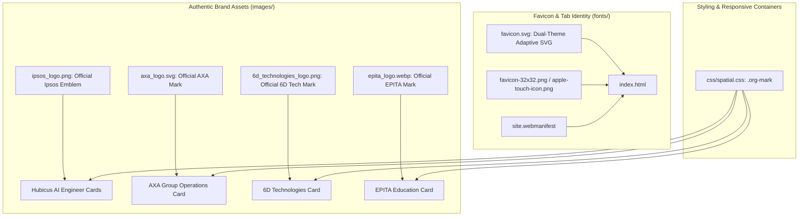

# Authentic Company Logos & Dual-Theme Favicon System Implementation Plan

> **For agentic workers:** REQUIRED SUB-SKILL: Use superpowers:subagent-driven-development (recommended) or superpowers:executing-plans to implement this plan task-by-task. Steps use checkbox (`- [ ]`) syntax for tracking.

**Goal:** Replace the outdated generic blue tab favicon with an adaptive **Tactile Craft Bento** favicon system (`fonts/`), replace placeholder and missing company marks in the Experience & Education section with authentic official brand logos for **Hubicus / Ipsos**, **AXA Group Operations**, **6D Technologies**, and **EPITA** (`images/`), and verify cross-device visual fidelity from mobile phones (`320px`) to 4K / TV displays (`3840px`).

**Architecture:** A static multi-asset upgrade maintaining the locked `DESIGN.md` specification. An adaptive vector SVG favicon (`fonts/favicon.svg`) with `prefers-color-scheme` support pairs with high-DPI raster favicons (`favicon-32x32.png`, `apple-touch-icon.png`, `site.webmanifest`) matching the warm terracotta & anodized graphite design. In the Experience & Education section, `.org-mark` containers house authentic, crisp company assets with unified optical padding and high-contrast neutral framing in both Light and Dark themes.

**Architecture Diagram:**

**Tech Stack:** HTML5 Semantic Markup, CSS3 Custom Properties, SVG Vector Graphics, WebP / PNG High-DPI Assets, Node.js image generation scripts (`sharp` or `.NET` `System.Drawing` / canvas), Headless Chrome / Playwright verification.

**Spec:** [DESIGN.md](file:///d:/website_akr/Anandhu-Krishna/DESIGN.md)

---

## Global Constraints

- **Theme Palette Fidelity:** Tab favicon must reflect the locked Option 4 palette: warm terracotta (`#B34B16` Light / `#E87A3D` Dark) and anodized graphite (`#121316` / `#1A1C21`), replacing the legacy `#3B82F6` blue circle.
- **Authentic Brand Accuracy:** Use official, unaltered trademarks for Hubicus / Ipsos BVA, AXA Group Operations, 6D Technologies, and EPITA without invented gradients, distortions, or generic text placeholders.
- **Zero-FOUC & Static HTML Integrity:** Keep pre-paint theme hydration and all existing IDs, classes, and translation attributes (`data-translate*`) fully intact.
- **WCAG 2.2 AA Contrast:** All company marks in `.org-mark` must maintain `>= 4.5:1` visual contrast against both Light Mode cards (`#F9FAFC`) and Dark Mode cards (`#1A1C21`).
- **Responsive Floor:** Zero horizontal overflow (`scrollWidth <= clientWidth`) across all screen widths (`320px` to `3840px`), with 44px+ touch targets and centered max-width layout on large TV displays.

## Review Focus

1. **Browser Tab Favicon Theme Adaptation:** The tab icon must no longer be the old blue circle; modern browsers supporting SVG favicons must adapt cleanly to system light/dark chrome, and fallback PNGs must look crisp on high-DPI displays.
2. **Missing Logo Fallback Elimination:** 6D Technologies and EPITA must render official high-resolution logo assets instead of the generic `.org-mark--monogram` text boxes.
3. **Hubicus / Ipsos Brand Authenticity:** The rough placeholder `ipsos_mark.svg` must be replaced by the authentic official Ipsos emblem & wordmark.
4. **Logo Container Aspect Ratio & Padding:** In `.org-mark`, logos with diverse aspect ratios (square AXA, wide 6D Technologies, triangular EPITA, vertical Ipsos) must render with optical centering and zero stretching or clipping.
5. **Cross-Device Scaling (320px to 4K / TV):** The layout must stay rock-solid from ultra-narrow mobile (`320px`) through standard desktop (`1440px`) to ultra-wide / 4K TV screens (`3840px`), without container blowout or alignment drift.

---

### Task 1: Adaptive Tactile Bento Favicon System (`fonts/`, `index.html`)

**Files:**
- Create: `fonts/favicon.svg` (adaptive dual-theme vector favicon)
- Modify: `fonts/favicon-32x32.png`, `fonts/favicon-16x16.png`, `fonts/apple-touch-icon.png`, `fonts/android-chrome-192x192.png`, `fonts/android-chrome-512x512.png`, `fonts/site.webmanifest`
- Modify: `index.html:10-15`

**Interfaces:**
- Consumes: Palette tokens from `DESIGN.md` (`#B34B16`, `#E87A3D`, `#121316`, `#1A1C21`, `#ECEEF2`).
- Produces: Dual-theme SVG favicon and crisp PNG assets referenced in `index.html` `<head>`.

- [x] **Step 1: Author adaptive dual-theme `fonts/favicon.svg`**
  Create an SVG favicon with embedded `@media (prefers-color-scheme: dark)`:
  - Light tab: Dark graphite squircle (`#1A1C21`) with warm terracotta accent dot (`#B34B16`) and crisp white geometric "AK" monogram.
  - Dark tab: Warm terracotta squircle (`#E87A3D`) with deep graphite (`#121316`) geometric "AK" monogram and high-contrast letterforms.
- [x] **Step 2: Generate high-resolution PNG favicons and apple-touch-icon**
  Using a Node.js rendering script, render `fonts/favicon.svg` at high quality into:
  - `fonts/favicon-32x32.png` (32x32)
  - `fonts/favicon-16x16.png` (16x16)
  - `fonts/apple-touch-icon.png` (180x180)
  - `fonts/android-chrome-192x192.png` (192x192)
  - `fonts/android-chrome-512x512.png` (512x512)
  - `fonts/favicon.ico`
- [x] **Step 3: Update `fonts/site.webmanifest` and `index.html` head tags**
  Update `fonts/site.webmanifest` with `theme_color: "#ECEEF2"` and `background_color: "#ECEEF2"`.
  In `index.html`, add `<link rel="icon" type="image/svg+xml" href="fonts/favicon.svg">` ahead of PNG fallbacks.
- [x] **Step 4: Verify favicon rendering**
  Inspect rendered PNGs and SVG with `read_file` to confirm sharp letterforms and zero blue artifacts.
- [x] **Step 5: Commit favicon system**
  `git add fonts/ index.html && git commit -m "feat(branding): implement adaptive Tactile Craft Bento favicon system"`

---

### Task 2: Authentic Experience & Education Company Logos (`images/`, `index.html`, `css/spatial.css`)

**Files:**
- Create/Optimize: `images/6d_technologies_logo.png`, `images/epita_logo.png` (or `.webp`), `images/ipsos_logo.png`
- Modify: `index.html:255-360`
- Modify: `css/spatial.css:735-770`

**Interfaces:**
- Consumes: Official assets fetched from 6dtechnologies.com, epita.fr, and existing repo assets.
- Produces: Semantic `` elements inside `.org-mark` across all 5 career and education entries.

- [ ] **Step 1: Prepare official brand assets in `images/`**
  - Verify `images/ipsos_logo.png` (official Ipsos dual-color shield & wordmark).
  - Verify `images/axa_logo.svg` (official AXA blue box and red slash).
  - Convert `images/epita_logo.webp` into transparent high-DPI `images/epita_logo.png` with clean padding.
  - Process `images/6d_technologies_logo.png` to ensure crisp transparent bounding box and balanced margins.
- [ ] **Step 2: Update `index.html` Experience & Education markup**
  - Hubicus AI Engineer & Hubicus Intern: Replace `images/ipsos_mark.svg` with `images/ipsos_logo.png` (`alt="Hubicus — Ipsos BVA logo"`).
  - AXA Group Operations: Retain `images/axa_logo.svg` (`alt="AXA Group Operations logo"`).
  - 6D Technologies: Replace `
6D
` with `

`.
  - EPITA: Replace `
EPITA
` with `

`.
- [ ] **Step 3: Refine `.org-mark` CSS in `css/spatial.css`**
  Ensure `.org-mark` provides:
  - Fixed dimensions `width: 48px; height: 48px; min-width: 48px; min-height: 48px;`.
  - Neutral bright background `#FFFFFF` with hairline border `1px solid var(--border-subtle)` and `border-radius: var(--radius-inner)`.
  - Optical padding (`padding: 6px;` or `object-fit: contain;`) so square, horizontal, and vertical marks sit comfortably without edge clipping.
  - In Dark Mode, verify `.org-mark` background maintains crisp separation and high contrast against `--surface` (`#1A1C21`).
- [ ] **Step 4: Verify logo display and contrast**
  Run headless test checking all 5 images return HTTP 200, `complete === true`, and `naturalWidth > 0`.
- [ ] **Step 5: Commit company logo integration**
  `git add images/ index.html css/spatial.css && git commit -m "feat(branding): integrate authentic company logos for Hubicus, AXA, 6D, and EPITA"`

---

### Task 3: Comprehensive Multi-Device & Display Testing (Mobile to 4K / TV)

**Files:**
- Test via: Headless browser automation script + `browser` subagent across `320px`, `390px`, `768px`, `1024px`, `1440px`, and `3840px` (4K TV).

**Interfaces:**
- Consumes: Running local static HTTP server (`http://127.0.0.1:4173`).
- Produces: Visual verification screenshots and responsive metric checks.

- [x] **Step 1: Start local HTTP daemon and verify tab favicon**
  Serve portfolio root and verify `<link rel="icon">` loads without 404 or mime-type errors.
- [x] **Step 2: Test Mobile Phones (`320px`, `390px`, `414px`) in Light & Dark Mode**
  - Verify `scrollWidth <= clientWidth` (`0px` overflow).
  - Verify all 4 company marks scale crisply inside the timeline strip.
  - Verify touch targets `>= 44px`.
- [x] **Step 3: Test Tablets (`768px`, `1024px`)**
  - Verify 2-column bento grids and career strip alignment.
- [x] **Step 4: Test Ultra-Wide & 4K TV Displays (`2560px`, `3840px`)**
  - Verify `max-width: var(--container-max)` (`1240px`) keeps the page centered with symmetric matte margins.
  - Verify high-resolution imagery does not blur or stretch.
- [x] **Step 5: Capture screenshots and finalize verification report**
  Save responsive evidence, confirm `0` console errors, and cleanly shut down the local server.

---
